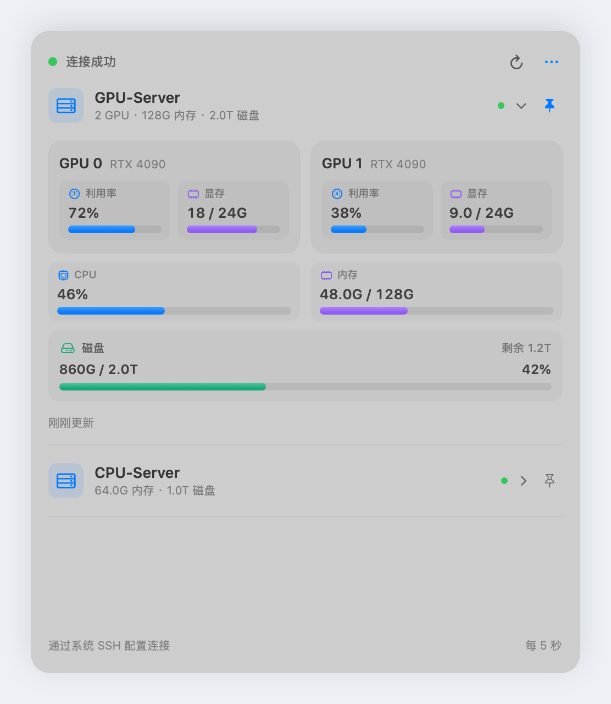

<h1 align="center">Server Monitor</h1>

<p align="center">在 macOS 菜单栏查看服务器的 GPU、CPU、内存和磁盘使用情况。</p>

## 预览

<p align="center">
  
</p>

## 安装

需要 macOS 14+ 和 Xcode Command Line Tools。

```sh
git clone https://github.com/ic1fy/Server-Monitor.git
cd Server-Monitor
./scripts/build_app.sh
```

将生成的 `outputs/Server Monitor.app` 拖入「应用程序」并打开。

Intel Mac 构建时使用 `SERVER_MONITOR_ARCHS=x86_64 ./scripts/build_app.sh`。

## 使用

### 1. 配置连接

在 Mac 的 `~/.ssh/config` 中添加服务器，已有配置可以直接使用：

```sshconfig
Host my-server
    HostName server.example.com
    User your-user
    IdentityFile ~/.ssh/id_ed25519
```

将地址、用户名和密钥路径替换为自己的信息，`my-server` 是自定义的服务器别名。

先运行 `ssh my-server` 完成首次连接确认，再检查能否免交互登录：

```sh
ssh -o BatchMode=yes my-server true
```

命令无报错退出即可。若仍需输入密码，请先配置 SSH 密钥登录。

### 2. 添加服务器

打开应用，点击屏幕顶部的菜单栏图标，进入 **「… → 服务器设置」**。

填写 `my-server`，有多台服务器时点击 **「添加服务器」** 逐一填写。选择刷新间隔后点击 **「保存」**。

### 3. 查看状态

- 点击服务器名称，展开或折叠详细指标。
- 点击右侧图钉，选择菜单栏显示哪台服务器的数据。
- 将鼠标移到磁盘卡片，查看挂载路径。
- 点击右上角刷新按钮，立即更新数据；自动刷新间隔可在设置中调整。

查看 NVIDIA GPU 指标需要服务器能运行 `nvidia-smi`。没有 GPU 的服务器也可以查看 CPU、内存和磁盘。
